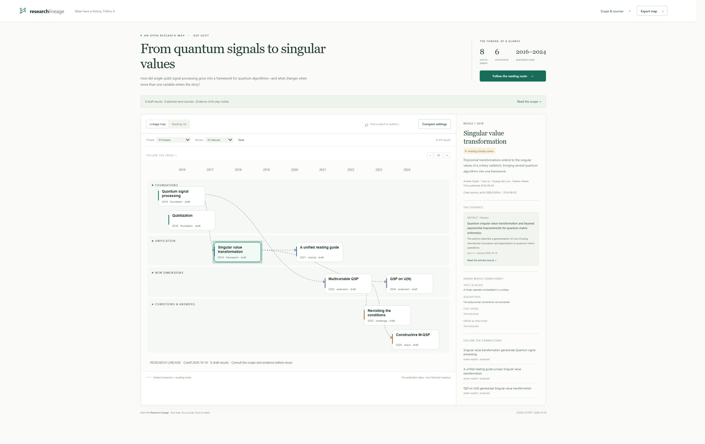

# Research Lineage

**Ideas have a history. Follow it.**

[](https://github.com/Chengkai-Zhu/research-lineage/actions/workflows/ci.yml)

Turn a research question into an interactive map of results, assumptions, and the
evidence connecting them. An agent skill plus a small Python toolkit. Local files,
no account, no runtime dependencies, and no external assets in your exported map.

[Download the demo](https://github.com/Chengkai-Zhu/research-lineage/releases/latest)
· [Install the skill](docs/quickstart.md#use-the-standalone-skill)
· [Data format](skills/research-lineage/references/data-guide.md)
· [Roadmap](docs/roadmap.md)



## See the story, check the evidence

- **Follow results, not only papers.** Trace a generalization, a changed condition,
  a targeted critique, or a tutorial through a chronological map.
- **Inspect every connection.** Open its source version, locator, explanation,
  and review status. Citation alone does not establish intellectual inheritance.
- **Compare the setting before the claim.** Put input models, assumptions, costs,
  and error side by side. Unknowns stay visible.
- **Read it as a route.** A guided sequence and a text reading list make the map
  useful for a first reading, a class, or a research-group discussion.
- **Take it with you.** Export interactive HTML, editable SVG, structured JSON,
  and a review report. Keep a map in Git and inspect its changes.

The first example follows eight QSP/QSVT papers and six proposed relationships.
It is an **abstract-grounded draft**, not an expert-certified or complete history.
See [source checks and limitations](docs/sources.md).

A second worked map follows [neural machine translation from fixed vectors to
attention](examples/nmt-attention/README.md): six primary papers checked at
section level, including an explicit multi-version source. See the
[new-question end-to-end test](docs/test-reports/test-feature-20261017-nmt.md).

## Try it in a minute

Requires Python 3.11+. No model key or network is needed to run the demo.

```sh
git clone https://github.com/Chengkai-Zhu/research-lineage.git
cd research-lineage
python -m pip install .
research-lineage demo --out output/demo
```

Open `output/demo/map.html`. Or download and extract the demo ZIP from
[Releases](https://github.com/Chengkai-Zhu/research-lineage/releases/latest) and open
`map.html` directly, with no Python installation.

## Give the skill a question

Install the self-contained skill ZIP from the release into your agent's skills
folder. It includes the Python runtime code; it does not require this checkout.
See [installation and usage](docs/quickstart.md).

> Use research-lineage to map how quantum signal processing developed into QSVT.
> Show which assumptions changed and where each connection is supported. Give me
> an offline map I can use in a reading group.

The skill uses the search/document capabilities of your host agent. It does not
provide credentials, a hosted research agent, or automatic scientific verification.
You can use the same format for other questions; worked examples cover quantum
algorithms and neural machine translation.

```sh
research-lineage init "How did this research question evolve?" --id my-question --out map.json
# Populate the draft with checked sources, results, settings, and evidence.
research-lineage validate map.json
research-lineage build map.json --out output/my-question
research-lineage diff previous.json revised.json --out changes.json
```

`init` creates an empty draft. `build` refuses empty or invalid maps. No hidden model
call fills missing evidence. Read the [data guide](skills/research-lineage/references/data-guide.md)
for the full authoring contract.

## Where this fits

[Connected Papers](https://www.connectedpapers.com/about),
[ResearchRabbit](https://www.researchrabbit.ai/), and [Litmaps](https://www.litmaps.com/)
already make discovery and visual exploration useful. Open skills such as
[research-genealogy](https://github.com/unumbrela/research-genealogy) also trace research history.

Research Lineage focuses on the combination of **result-level evidence, explicit
setting changes, and portable reading experiences**. We aim to make checking and
maintaining a map easier. That is a product hypothesis, not a claim of global novelty.

## Development

```sh
python -m pip install -e ".[dev]"
python -m pytest --cov=research_lineage
python -m ruff check src tests scripts skills
python scripts/package_skill.py --out dist
python -m build
```

[Product design](docs/design/research-lineage.md) · [Plan audit](docs/product-audit.md)
· [Verification](docs/verification.md) · [Contributing](CONTRIBUTING.md)

A useful contribution can be a single corrected assumption or a better source
anchor. Keep it inspectable. If this helps your research, sharing a map or starring
the repository helps others find it.

## License

Apache-2.0. See [LICENSE](LICENSE). Papers retain their own copyrights; the repository
contains original annotations and source links, not redistributed full-text papers.
