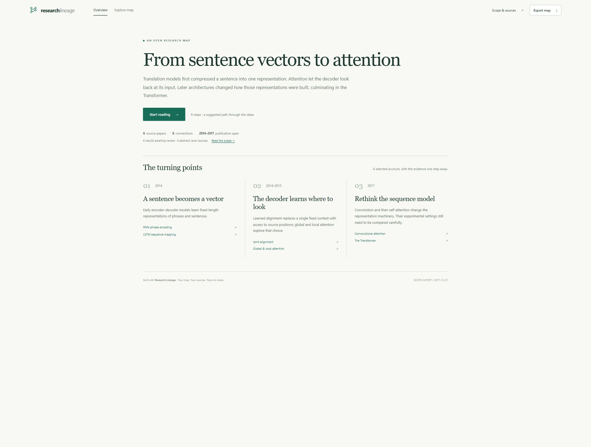

# Skill-first workflow acceptance record

**Research-workflow acceptance withdrawn on 2026-10-17:** the software observations
below remain a historical record, but the four-work authored surface-code example
does not establish an adequate independent single-input research run. #14 and #12
were reopened to correct the research contract and publish fresh execution and
coverage evidence. Do not use the earlier issue-closure table as current status.

Date: 2026-10-17. Version: 0.2.0. This is a software and agent workflow record,
not independent scholarly review or a participant study. Machine-readable
[observations](v0.2-observations.json) retain counts, timings and provider failures.



## Inputs and actual outputs

The primary product is an agent skill. The host researches and authors evidence;
the Python commands prepare, check and render it. `start` alone does not perform
a literature review or replace an empty draft with the bundled map.

| Input exercised | Observed result | Boundary |
| --- | --- | --- |
| `请整理quantum signal processing这个方向的发展历史` | Topic brief, Chinese language inferred, 12-source budget, valid empty draft | Deterministic intake check; no research fabricated by the helper |
| `Trace how attention changed neural machine translation.` | Empty draft → host-authored six-paper map → validation/build → browser overview | Reuses the primary sources checked in the earlier NMT run; no new exhaustive search claimed |
| `https://arxiv.org/abs/2408.13687v1` | Pinned paper brief → four-work surface-code history → validation/build → 4/4 reading steps | New paper-centered map; two full-text and two abstract-level sources |

The [surface-code research log](../../examples/surface-code/README.md) records
source versions, reading locations, excluded later work and access limitations.
The [NMT research log](../../examples/nmt-attention/README.md) records the six
primary sources and domain-specific comparisons. Neither copies QSVT assumptions
into unrelated research. The seed is a 2024 paper selected for this test, not a
claim to be the latest surface-code publication in 2026.

## Issue acceptance

| Issue | Executed verification | Observed result |
| --- | --- | --- |
| #8 Bounded discovery | `pytest tests/test_discovery.py -q`; explicit live provider smokes | Pagination/caps, HTTP 429, timeout, malformed fields and partial recovery checked. Rejected records retain provider data. Crossref returned 3 candidates in 1 capped request; arXiv timed out and returned 0 with a failure log. No successful live arXiv result is claimed. |
| #9 Identity and proposal gates | `pytest tests/test_identity.py tests/test_extraction.py -q`; six-case manifest | Distinct identifiers do not merge by title; revisions survive discovery→reconciliation; conflicts reject. Citation-only semantics, missing text and incomparable bounds abstain. All accepted candidates remain proposed. |
| #11 Temporal proposals | `pytest tests/test_temporal_updates.py -q`; surface-code cutoff at 2023-01-01 | Later cited versions are excluded even when the work first appeared earlier. Inputs unchanged; alternative ISO date forms normalize to the same date; historical reconstruction explicitly unavailable. |
| #12 Transfer workflow | Build QSP, NMT and surface-code through the same runtime | 8/6/4 works respectively; all validate and produce four artifacts. Domain settings and limitations retained. Human transfer-quality judgments remain in #10. |
| #14 Simple inputs | `pytest tests/test_intake.py -q`; topic and paper runs above | No required bibliography, IDs or dates from the user; empty build rejects; private PDF helper never uploads; titles remain unresolved until checked. |
| #15 Reading experience | Actual browser scenarios below; `pytest tests/test_reading.py -q` | Overview-first presentation, complete reading routes, evidence and versions on demand, narrow layout, complete filtered exports, compatible legacy fallback. |
| #16 Bilingual README | English/Chinese document and local-link checks; source archive inspection | Reciprocal language links, equivalent inputs/install/limits, Chinese README included in the source distribution. |
| #17 Evaluation tools | `pytest tests/test_evaluation.py -q`; `evaluate` and `study` commands | Six engineering cases: 2 propose, 4 abstain, all agree with fixture labels. Per-type metrics exposed; empty study reports 0 participants and unavailable metrics. |

The small gate manifest tests engineering rules. Its agreement is **not** a
scientific extraction-accuracy benchmark. No external reviewers, independent
scientific labels or participant observations have been fabricated. #10 stays open.

## Browser observations

Generated files were served over loopback HTTP in a Chromium-based browser.

| Action | Observed behavior |
| --- | --- |
| Open each of QSP, NMT and surface-code | One primary Start reading action, concise narrative and three source-linked turning points; no open inspector or filters. Proposed status and scope remain visible. |
| Open a legacy map without narrative | Neutral “A few places to begin” fallback; no invented historical turning-point claims. |
| Complete the routes | QSP 8/8, NMT 6/6 and surface-code 4/4 steps visited. First Previous and last Next disabled; Exit hides route controls. |
| Activate a result with Enter / relationship with Space | Correct result/connection appears; details start collapsed. |
| Open evidence | Exact pinned source, version and locator appear; surface-code seed points to v1 PDF sections I–II, pp. 1–3. |
| Open source index | ConvS2S v1 explicitly “Recorded version; not cited”; v2 “Cited in this map”. |
| Empty search after selecting a relationship | 0/6 message; both Reset and manual clearing restore the relationship details. |
| Compare without a selection | Dialog opens; unknown cost stays “Not extracted”; selected Transformer setting remains a layer cost rather than total training cost. |
| Narrow overview and reading list | Actual viewport 389 CSS px, document client/scroll widths both 367 px; no page-level horizontal overflow. Cards stack and evidence remains accessible. |
| Export while filtered to 2/6 NMT results | Actual HTML, SVG and JSON files saved through the visible download links. Each recovers the complete input, including narrative, 6 works/results/relations/evidence and all versions. |
| Inspect downloaded HTML/SVG | HTML has embedded assets, complete data, closed dialog and no stale blob links; SVG parses, retains all six nodes and complete JSON metadata. |

Export verification found that synthetic button-triggered SVG/JSON downloads did
not produce files in this browser despite success text. The controls now use
native download links and say “Download requested”. The actual downloaded bytes
were then compared with the source map. A timed-out browser download-event wait
is not counted as successful verification.

The automation environment blocks `file:` navigation, so reopening a saved HTML
through that protocol is not claimed. The same self-contained viewer was exercised
over loopback and its bytes inspected. No assistive-technology audit is claimed.

## Automated checks and independent code review

Local Python 3.14.4: **125 passed, 3 skipped**, **93% Python line coverage**.
The three skips are existing hard-link tests restricted by the local sandbox;
ordinary CI filesystems run those cases. Ruff and the host's UTF-8 skill validator
pass. CLI tests also check malformed input and refusal to overwrite prior reports.

The standalone 0.2.0 skill ZIP was extracted outside the checkout and ran with
`python -I -S`: it created an empty paper brief and built the surface-code history
byte-for-byte equal to the canonical runtime. The wheel built from the source
archive was installed with `pip --no-index --no-deps` into a separate target.
The source archive includes the Chinese README, screenshots and worked histories.
Both READMEs' local links resolve.

A fresh-context code reviewer found four P2 issues: equivalent date spellings
changed availability, separate arXiv revisions were lost, rejected candidates
lacked identity, and malformed Crossref titles could be truncated. All four were
fixed with regressions; the reviewer reran the original cases and 18 targeted tests,
finding no remaining Important+ issue. A later narrow review accepted the native
export-link change. Git harm-signals audit: **PASS**.

CI and merge status are authoritative in the linked pull request; local results
alone do not establish that CI has passed.

## Effort and reproducibility

The final validation/build command pairs took approximately 1.11 s (QSP), 1.06 s
(NMT) and 1.04 s (surface-code) on this machine. These are command wall times,
**not research time**. Active source reading and authoring were not instrumented;
their duration is unavailable, rather than estimated from elapsed chat time.
The source maps, research logs and observed failures are published for replay.

```sh
python -m pytest --cov=research_lineage --cov-report=term-missing
python -m ruff check src tests scripts skills
python -m research_lineage demo --out output/qsp
python -m research_lineage build examples/nmt-attention/map.json --out output/nmt
python -m research_lineage build examples/surface-code/map.json --out output/surface-code
python -m research_lineage evaluate examples/evaluation/gates.json
python -m research_lineage study examples/evaluation/study-empty.json
python scripts/package_skill.py --out dist
python -m build
```
